# Renti — Sistema de renta de viviendas

## 1. Descripción breve

Renti es una aplicación para consultar y administrar casas y habitaciones en renta. Su objetivo es facilitar la publicación de propiedades, mostrar información de cada vivienda y permitir que los usuarios consulten las opciones disponibles.

La aplicación cuenta con inicio de sesión, registro de usuarios, diferentes tipos de acceso, listas de propiedades y formularios para registrar información.

## 2. Los 3 tipos de usuario y sus dashboards

La aplicación contempla tres tipos de usuario, cada uno con diferentes funciones según su rol.

### Administrador

El administrador se encarga de gestionar la información del sistema y consultar los registros disponibles. Tiene acceso a las funciones de administración que se hayan implementado.

### Cliente

El cliente puede consultar las casas y habitaciones disponibles, revisar sus características y conocer la información de las propiedades publicadas.

### Operador o invitado

Este usuario cuenta con las funciones de consulta u operación que correspondan a su rol. Sus permisos dependen de la configuración de la aplicación.

## 3. Manejo de estado elegido y por qué

El manejo de estado permite conservar y actualizar la información que se muestra en la aplicación cuando el usuario realiza alguna acción o cambia de pantalla.

En Renti, se busca mantener la información relacionada con la sesión del usuario, su rol y los registros de las propiedades. También se contempla la actualización de las listas cuando se agregan o modifican datos.

El objetivo es que la información se muestre correctamente durante la navegación y que los cambios realizados se reflejen según el funcionamiento de la aplicación.

**Manejo de estado utilizado:** [escribe aquí la solución que implementaste, por ejemplo, Provider, Riverpod, setState u otra].

**Almacenamiento de datos:** [escribe aquí dónde se guardan los datos, por ejemplo, SQLite, Firebase, una API o almacenamiento local].

## 4. Cómo ejecutar la aplicación

Para ejecutar el proyecto, sigue estos pasos:

1. Clona el repositorio desde GitHub.
2. Abre la carpeta del proyecto.
3. Instala las dependencias necesarias.
4. Inicia la aplicación en un dispositivo físico o emulador.
5. Comprueba que las pantallas y las funciones estén disponibles.

**Comandos de ejemplo para Flutter:**

```bash
flutter pub get
flutter devices
flutter run
```

Si se utiliza un emulador específico, primero debe iniciarse y seleccionarse el dispositivo correspondiente.

## 5. Demostración al docente

La aplicación se mostrará funcionando en vivo para comprobar que inicia correctamente y que sus principales funciones trabajan como se espera.

Durante la demostración se revisará:

- El splashscreen y su transición al inicio de sesión.
- El inicio de sesión y el registro con sus validaciones.
- Los tres dashboards y sus opciones correspondientes.
- La lista de propiedades, sus detalles y el estado vacío.
- El formulario para registrar una propiedad.
- La navegación entre las diferentes pantallas.
- La conservación y actualización de los datos según el almacenamiento implementado.

**Dispositivo o emulador utilizado:** [Android/iOS, modelo y versión].

**Fecha de demostración:** [fecha].

**Modalidad:** [presencial o videollamada].

## 6. Screenshots

Las siguientes capturas muestran las pantallas principales y las evidencias funcionales de Renti.

### 6.1 Splashscreen

Muestra la pantalla inicial que aparece al abrir la aplicación.

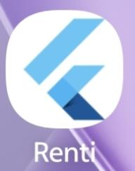

### 6.2 Autenticación

Estas capturas muestran el acceso al sistema y el registro de usuarios.

**Inicio de sesión**

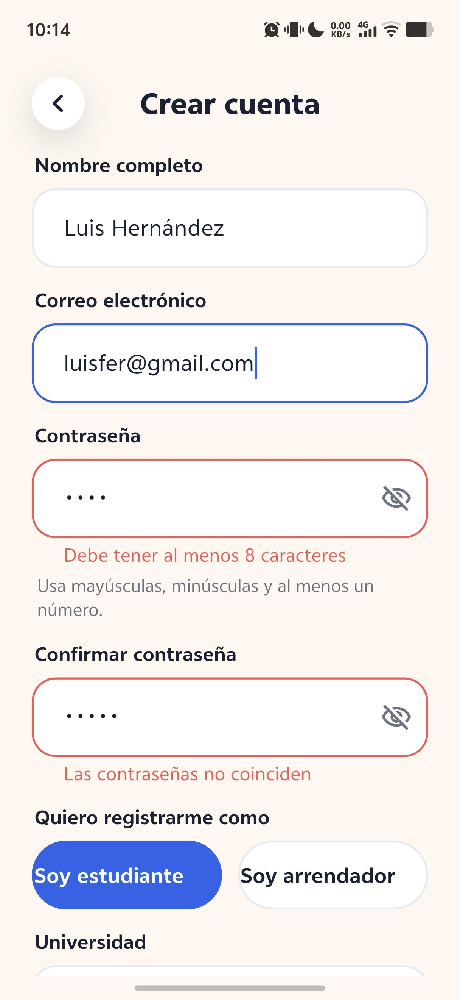

**Registro con selector de rol**

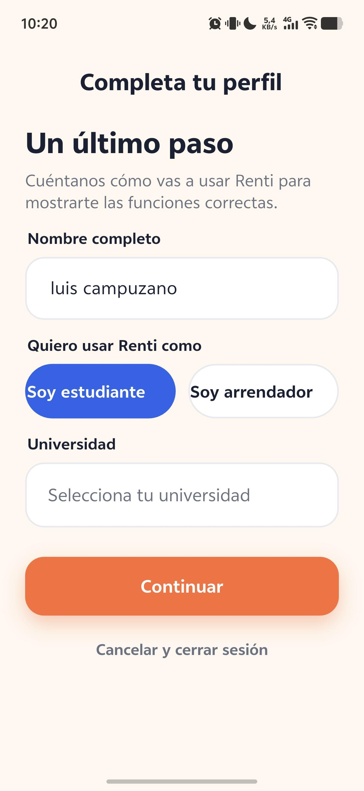

### 6.3 Dashboards de los usuarios

Cada captura corresponde a la pantalla principal de un tipo de usuario.

**Usuario 1: Administrador**

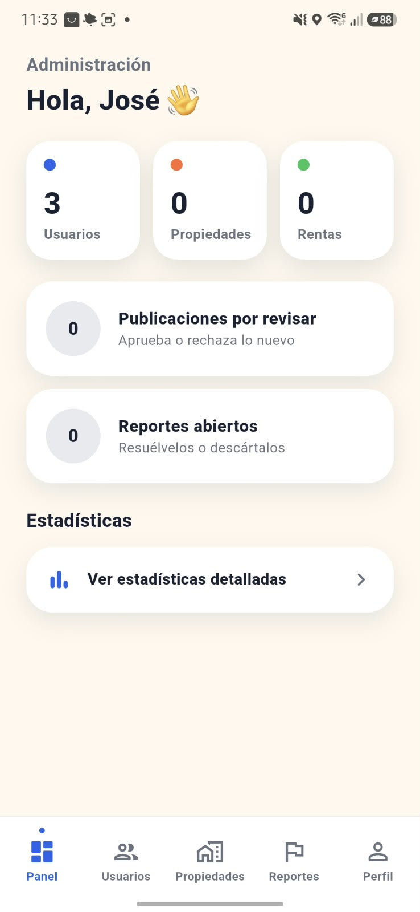

**Usuario 2: Cliente**


**Usuario 3: Operador o invitado**

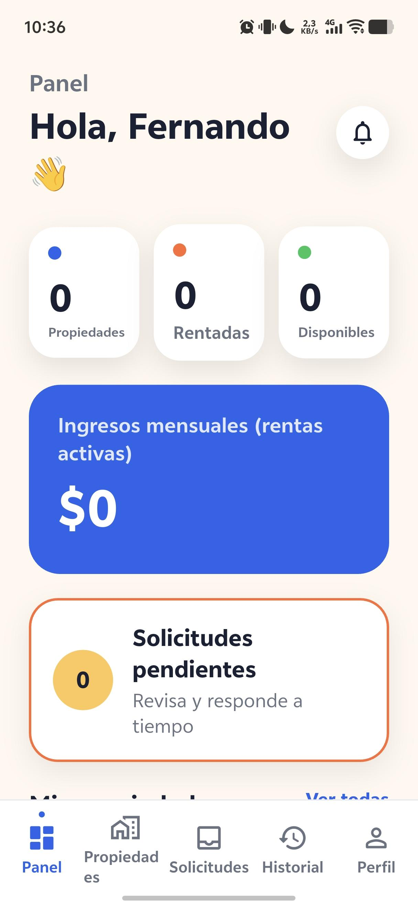

### 6.4 Listas de propiedades

Estas capturas muestran la consulta de viviendas, los detalles de una propiedad y el estado vacío.

**Lista principal de casas**

Muestra varias propiedades con información cargada por la aplicación.

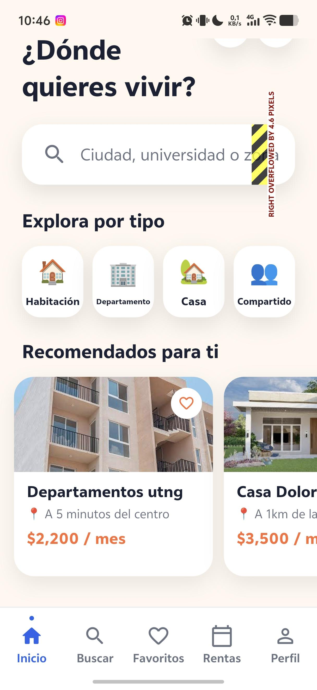

**Detalle de una propiedad**

Muestra la información específica de una casa o habitación seleccionada.

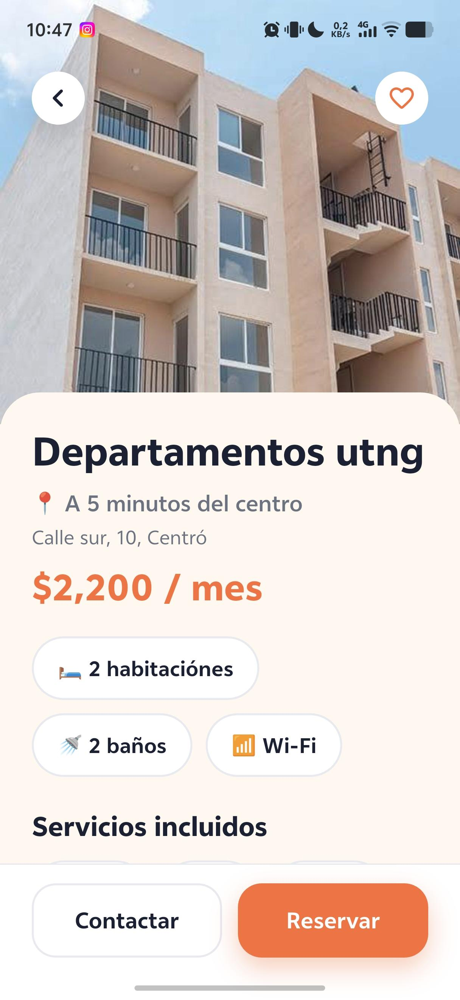

**Estado vacío**

Muestra el mensaje que aparece cuando no existen propiedades para mostrar.


### 6.5 Formularios

**Registro de una propiedad**

Muestra el formulario para ingresar los datos de una casa o habitación en renta. La evidencia debe mostrar el formulario rellenado o un mensaje de guardado exitoso.

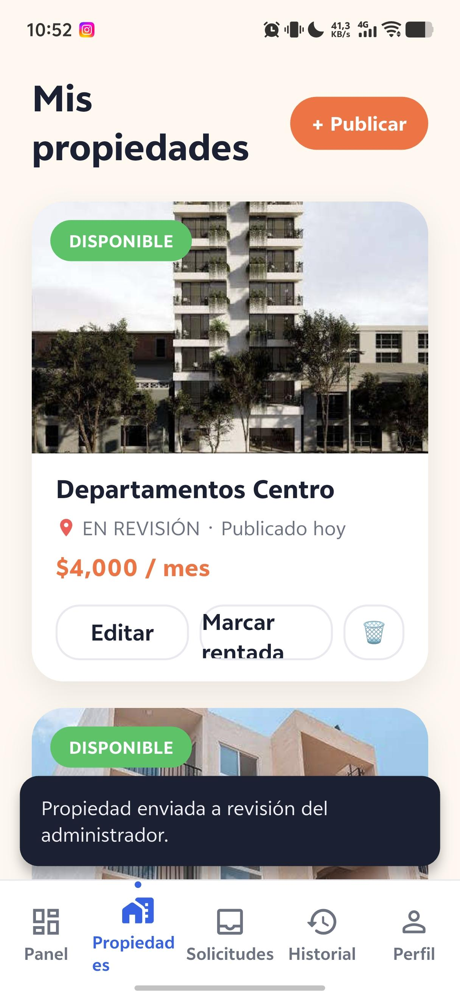

### 6.6 Evidencias funcionales

**Aplicación ejecutándose en un dispositivo**

Fotografía del equipo o dispositivo donde se observa la aplicación funcionando.

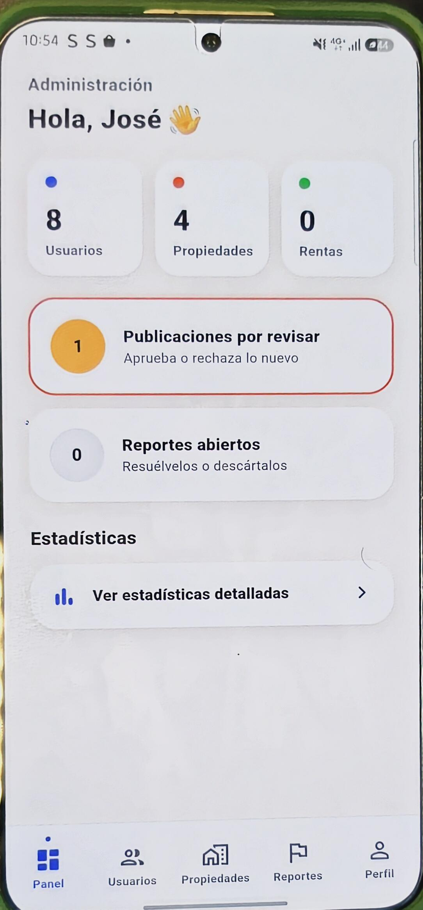

**Flujo de navegación**

Muestra el recorrido desde el inicio de sesión hasta el dashboard, la lista de casas y el formulario de registro.


#### Capturas complementarias del flujo

Las siguientes imágenes permiten observar por separado cada una de las cuatro etapas de navegación.

**1. Inicio de sesión**


**2. Dashboard**

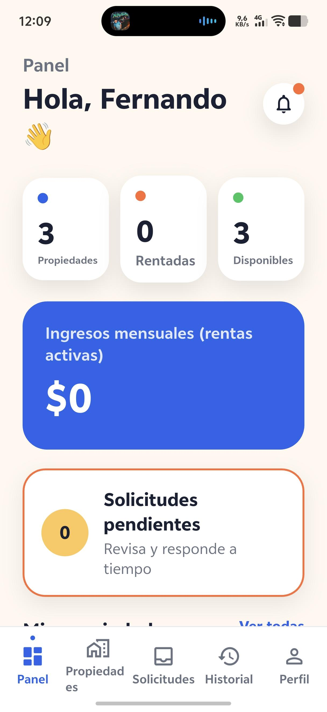

**3. Lista de casas**

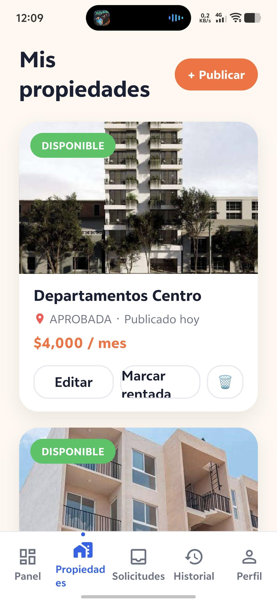

**4. Formulario de registro**

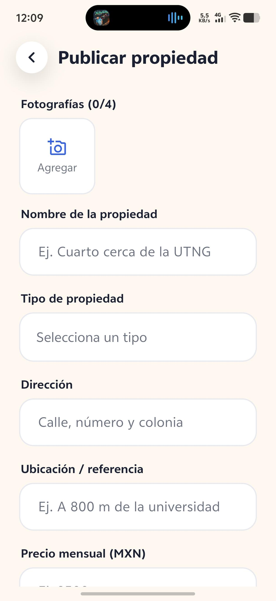


